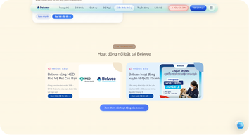

<p align="center">
  
</p>

<h1 align="center">Belwee Pet Clinic — Web Platform</h1>

<p align="center">
  <a href="https://github.com/khangcaheo300582-boop/demo-belwee-pet-clinic-by-yujaa/raw/main/public/belwee-logo-intro-a.mp4">
    ▶ Xem video intro có tiếng
  </a>
</p>

<p align="center">
  <strong>Veterinary Care • Digital Experience • Technology</strong>
</p>

<table>
  <tr>
    <td width="68%" valign="middle">
      Ứng dụng web toàn diện dành cho <strong>Belwee Pet Clinic</strong>, kết nối trực tiếp khách hàng nuôi thú cưng với đội ngũ bác sĩ và nhân viên phòng khám, phát triển trên nền tảng <strong>Next.js (App Router)</strong> và <strong>TypeScript</strong>.
      <br /><br />
      Hệ thống tập trung vào trải nghiệm người dùng, quy trình đặt lịch, theo dõi trạng thái lịch hẹn, phân quyền truy cập và giám sát hoạt động phòng khám.
    </td>
    <td width="32%" align="center" valign="middle">
      
    </td>
  </tr>
</table>

---

## NGƯỜI PHÁT TRIỂN

<table>
  <tr>
    <td width="68%" valign="middle">
      <strong>Tác giả / Người phát triển:</strong> Yujaaz (<code>khangcaheo300582-boop</code>)
      <br />
      <strong>Đơn vị áp dụng:</strong> Belwee Pet Clinic
      <br />
      <strong>Chuyên môn &amp; Vai trò:</strong> Full-stack Web Development, UI/UX &amp; Interactive Design, Digital Marketing &amp; Conversion Flow, Security &amp; QA Integration
      <br />
      <strong>Liên hệ:</strong> <code>khangcaheo300582@gmail.com</code>
      <br />
      <strong>Facebook:</strong> Gra Yujaa
    </td>
    <td width="32%" align="center" valign="middle">
      
    </td>
  </tr>
</table>

<p align="center">
  <a href="https://github.com/khangcaheo300582-boop">
    
  </a>
  <a href="https://facebook.com/">
    
  </a>
  <a href="mailto:khangcaheo300582@gmail.com">
    
  </a>
</p>

---

## TÍNH NĂNG

### 01. Đặt lịch và theo dõi trạng thái lịch hẹn

**Đặt lịch và theo dõi trạng thái lịch hẹn theo thời gian thực** qua các bước **State 1 → State 2 → State 3**, khách hàng nhận cập nhật từ phòng khám.

<p align="center">
  
</p>

### 02. Danh mục dịch vụ thú y

**Danh mục dịch vụ theo nhóm** dạng thẻ, giúp khách hàng dễ dàng tìm hiểu và chọn đúng dịch vụ phù hợp cho thú cưng.

<p align="center">
  
</p>

### 03. Giao diện trang chủ và kết nối thú y

**Giao diện trang chủ và kết nối thú y**, tập trung vào trải nghiệm người dùng, khả năng tiếp cận thông tin dịch vụ và tối ưu chuyển đổi khách hàng.

<p align="center">
  
  
</p>

### 04. Giám sát hệ thống

**Giám sát hệ thống:** theo dõi hoạt động, ghi log và phát hiện bất thường nhằm phục vụ kiểm soát và duy trì sự ổn định trong quá trình vận hành.

<p align="center">
  
  
</p>

### 05. Phân quyền truy cập

**Phân quyền truy cập** theo vai trò (quản trị, nhân viên, khách hàng), đảm bảo mỗi nhóm người dùng chỉ truy cập các chức năng phù hợp với quyền được cấp.

<p align="center">
  
  
</p>

---

## CÔNG NGHỆ SỬ DỤNG

| Nhóm | Công nghệ |
|---|---|
| Frontend & Framework | Next.js (App Router), React, TypeScript |
| Giao diện & Hiệu ứng | Tailwind CSS, Framer Motion |
| Xác thực & Thông báo | NextAuth, Nodemailer (SMTP), SSE |
| Bảo mật & Giám sát | Sentry, Middleware, CSRF & Rate Limit Protection |
| Kiểm thử & CI/CD | Vitest, Playwright, GitHub Actions |

---

## HƯỚNG DẪN CÀI ĐẶT VÀ CHẠY DỰ ÁN (LOCAL)

### 01. Clone repository

```bash
git clone https://github.com/khangcaheo300582-boop/demo-belwee-pet-clinic-by-yujaa.git

cd demo-belwee-pet-clinic-by-yujaa
```

### 02. Cài đặt thư viện

```bash
npm install
```

### 03. Cấu hình môi trường

Sao chép `.env.example` thành `.env.local`, sau đó điền các giá trị cấu hình cần thiết như database, SMTP và secret xác thực.

**Windows PowerShell:**

```powershell
Copy-Item .env.example .env.local
```

**macOS / Linux:**

```bash
cp .env.example .env.local
```

**Lưu ý:** Không chia sẻ hoặc đưa tệp `.env.local` chứa thông tin bí mật lên GitHub.

### 04. Khởi chạy dự án

```bash
npm run dev
```

Truy cập ứng dụng tại:

http://localhost:3000

---

## CẤU TRÚC THƯ MỤC

```text
demo-belwee-pet-clinic-by-yujaa/
│
├── app/                       # Next.js App Router
│   ├── api/                   # API routes và route handlers
│   └── (pages)/               # Các nhóm trang giao diện
│
├── components/                # Component giao diện dùng chung
│
├── lib/                       # Logic nghiệp vụ, tiện ích và cấu hình
│
├── public/                    # Ảnh, video, logo và tài nguyên tĩnh
│
├── screenshots/               # Ảnh chụp màn hình dự án
│
├── middleware.ts              # Middleware xác thực và bảo mật
├── next.config.mjs            # Cấu hình Next.js
├── tailwind.config.ts         # Cấu hình Tailwind CSS
├── vitest.config.ts            # Cấu hình Vitest
├── playwright.config.ts       # Cấu hình Playwright
│
└── README.md                  # Tài liệu dự án
```

---

<p align="center">
  <strong>Belwee Pet Clinic</strong>
  <br />
  Veterinary Care • Digital Experience • Technology
  <br /><br />
  <sub>© Belwee Pet Clinic — Phát triển bởi Yujaaz</sub>
</p>
