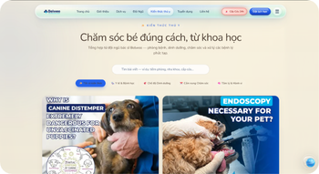

# Belwee Pet Clinic — Web Platform


https://github.com/user-attachments/assets/e4632983-0dc5-4ed2-8b7d-b5556a60a58d


> **Video Intro Logo:** [Xem `belwee-logo-intro-a.mp4`](https://github.com/khangcaheo300582-boop/demo-belwee-pet-clinic-by-yujaa/raw/main/public/belwee-logo-intro-a.mp4)

<p align="left">
  
  
  
</p>

Ứng dụng web toàn diện dành cho **Belwee Pet Clinic**, kết nối trực tiếp khách hàng nuôi thú cưng với đội ngũ bác sĩ và nhân viên phòng khám, phát triển trên nền tảng **Next.js (App Router)** và **TypeScript**.

---

## NGƯỜI PHÁT TRIỂN

- **Tác giả / Người phát triển:** Yujaaz (`khangcaheo300582-boop`)
- **Đơn vị áp dụng:** Belwee Pet Clinic
- **Chuyên môn & Vai trò:** Full-stack Web Development, UI/UX & Interactive Design, Digital Marketing & Conversion Flow, Security & QA Integration
- **Liên hệ:** `khangcaheo300582@gmail.com` • Facebook: **Gra Yujaa**


---

## TÍNH NĂNG

- Đặt lịch và theo dõi trạng thái lịch hẹn theo thời gian thực qua các bước **State 1 → State 2 → State 3**, nhận cập nhật tức thì từ phòng khám.

<p align="center">
  
</p>

- Hiển thị dịch vụ theo từng nhóm dạng thẻ, giúp khách hàng chọn đúng dịch vụ phù hợp cho thú cưng.

<p align="center">
  
</p>

- Giao diện trang chủ và kết nối thú y, tối ưu chuyển đổi khách hàng.

<p align="center">
  
  
</p>

- Giám sát hệ thống: theo dõi hoạt động, ghi log và phát hiện bất thường để vận hành ổn định.

<p align="center">
  
  
</p>

- Phân quyền truy cập theo vai trò (quản trị, nhân viên, khách hàng), đúng người đúng chức năng.

<p align="center">
  
  
</p>

---

## Công nghệ sử dụng

| Nhóm | Công nghệ |
| --- | --- |
| Frontend & Framework | Next.js (App Router), React, TypeScript |
| Giao diện & Hiệu ứng | Tailwind CSS, Framer Motion |
| Xác thực & Thông báo | NextAuth, Nodemailer (SMTP), SSE |
| Bảo mật & Giám sát | Sentry, Middleware, CSRF & Rate Limit Protection |
| Kiểm thử & CI/CD | Vitest, Playwright, GitHub Actions |

---

## Hướng dẫn cài đặt và chạy dự án (Local)

1. **Clone repository** về máy:

   ```bash
   git clone https://github.com/khangcaheo300582-boop/demo-belwee-pet-clinic-by-yujaa.git
   cd demo-belwee-pet-clinic-by-yujaa
   ```

2. **Cài đặt thư viện:**

   ```bash
   npm install
   ```

3. **Cấu hình môi trường:** sao chép `.env.example` thành `.env.local` rồi điền các giá trị cần thiết (database, SMTP, secret xác thực...).

   ```bash
   cp .env.example .env.local
   ```

4. **Khởi chạy** môi trường phát triển:

   ```bash
   npm run dev
   ```

   Truy cập: http://localhost:3000

---

## Cấu trúc thư mục

```text
belwee-pet-clinic/
├── app/               # Next.js App Router: pages, layouts, API routes
│   ├── api/           # Route handlers (API)
│   └── (pages)/       # Các trang giao diện
├── components/        # Component giao diện dùng chung
├── lib/               # Logic nghiệp vụ, tiện ích, cấu hình
├── public/            # Ảnh, video, logo, service worker (sw.js)
├── screenshots/       # Ảnh chụp màn hình dự án
├── middleware.ts      # Middleware xác thực, bảo mật
├── next.config.mjs    # Cấu hình Next.js
├── tailwind.config.ts # Cấu hình Tailwind CSS
├── vitest.config.ts   # Cấu hình unit test
├── playwright.config.ts # Cấu hình e2e test
└── README.md
```


