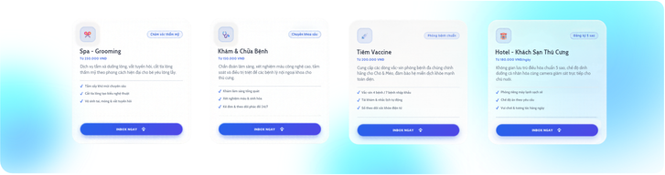

<p align="center">
  
</p>

<h1 align="center">BELWEE PET CLINIC</h1>

<p align="center">
  <strong>VETERINARY WEB PLATFORM</strong>
</p>

<p align="center">
  Nền tảng quản lý và kết nối dịch vụ thú y thông minh
</p>

<p align="center">
  <a href="https://github.com/khangcaheo300582-boop/demo-belwee-pet-clinic-by-yujaa">
    GitHub Repository
  </a>
  &nbsp; • &nbsp;
  <a href="https://github.com/khangcaheo300582-boop/demo-belwee-pet-clinic-by-yujaa/raw/main/public/belwee-logo-intro-a.mp4">
    ▶ Xem video giới thiệu
  </a>
</p>

---

## 01. GIỚI THIỆU DỰ ÁN

**Belwee Pet Clinic Web Platform** là hệ thống ứng dụng web được phát triển dành riêng cho hoạt động vận hành và kết nối khách hàng của Belwee Pet Clinic.

Dự án hướng đến việc xây dựng một môi trường tương tác trực tuyến hiện đại, nơi khách hàng có thể tiếp cận dịch vụ thú y, đặt lịch hẹn, theo dõi trạng thái xử lý và kết nối với đội ngũ bác sĩ, nhân viên phòng khám.

Hệ thống được phát triển trên nền tảng **Next.js (App Router)** và **TypeScript**, kết hợp các công nghệ giao diện, xác thực, bảo mật và giám sát hệ thống.

### Mục tiêu phát triển

- Số hóa quy trình tiếp nhận và chăm sóc khách hàng.
- Tối ưu trải nghiệm đặt lịch khám thú cưng.
- Tăng khả năng kết nối giữa khách hàng và phòng khám.
- Hỗ trợ quản lý hoạt động thông qua hệ thống phân quyền.
- Xây dựng giao diện hiện đại, trực quan và nhất quán.
- Chú trọng tính ổn định, bảo mật và khả năng mở rộng.

---

## 02. THÔNG TIN NGƯỜI PHÁT TRIỂN

<table>
  <tr>
    <td width="68%" valign="middle">

**Tác giả / Người phát triển:** Yujaaz

**GitHub:** `khangcaheo300582-boop`

**Đơn vị áp dụng:** Belwee Pet Clinic

**Vai trò chuyên môn:**

- Full-stack Web Development
- UI/UX & Interactive Design
- Digital Marketing & Conversion Flow
- Security & QA Integration

**Email:** khangcaheo300582@gmail.com

**Facebook:** Gra Yujaa

    </td>
    <td width="32%" align="center" valign="middle">
      
      <br />
      <strong>YU JAAZ</strong>
      <br />
      Developer
    </td>
  </tr>
</table>

<p align="center">
  <a href="https://github.com/khangcaheo300582-boop">
    
  </a>
  <a href="https://facebook.com/">
    
  </a>
  <a href="mailto:khangcaheo300582@gmail.com">
    
  </a>
</p>

---

## 03. HỆ THỐNG TÍNH NĂNG

### 3.1. Đặt lịch và theo dõi lịch hẹn

Hỗ trợ khách hàng gửi yêu cầu đặt lịch khám, đồng thời theo dõi tiến trình xử lý thông qua các trạng thái:

- State 1: Tiếp nhận yêu cầu.
- State 2: Xử lý và xác nhận.
- State 3: Cập nhật trạng thái hoàn tất quy trình.

Thông tin trạng thái được cập nhật theo thời gian thực, giúp khách hàng chủ động theo dõi lịch hẹn và nhận thông báo từ phòng khám.

### 3.2. Danh mục dịch vụ thú y

Hệ thống tổ chức dịch vụ theo từng nhóm trực quan, hỗ trợ khách hàng lựa chọn đúng nhu cầu chăm sóc thú cưng.

Các nhóm dịch vụ được giới thiệu bao gồm:

- Spa & Grooming.
- Khám và chữa bệnh.
- Tiêm vaccine.
- Hotel – Khách sạn thú cưng.

<p align="center">
  
</p>

### 3.3. Giao diện trang chủ

Thiết kế giao diện hướng đến trải nghiệm người dùng, tối ưu khả năng tiếp cận dịch vụ và điều hướng khách hàng.

### 3.4. Hệ thống giám sát

Tích hợp các thành phần hỗ trợ:

- Theo dõi hoạt động hệ thống.
- Ghi nhận nhật ký vận hành.
- Phát hiện các dấu hiệu bất thường.
- Hỗ trợ kiểm tra và xử lý lỗi.

### 3.5. Phân quyền truy cập

Hệ thống tổ chức quyền truy cập theo vai trò người dùng:

- Quản trị viên (Admin).
- Nhân viên (Staff).
- Khách hàng (Customer).

Mỗi nhóm được phân định quyền truy cập phù hợp với chức năng vận hành.

---

## 04. CÔNG NGHỆ SỬ DỤNG

| Nhóm công nghệ | Thành phần |
|---|---|
| Frontend Framework | Next.js (App Router) |
| UI Library | React |
| Programming Language | TypeScript |
| Styling | Tailwind CSS |
| Animation | Framer Motion |
| Authentication | NextAuth |
| Email Service | Nodemailer (SMTP) |
| Real-time Communication | Server-Sent Events (SSE) |
| Monitoring | Sentry |
| Security | Middleware, CSRF, Rate Limiting |
| Unit Testing | Vitest |
| E2E Testing | Playwright |
| CI/CD | GitHub Actions |

---

## 05. KIẾN TRÚC DỰ ÁN

Dự án được tổ chức theo cấu trúc module nhằm hỗ trợ quản lý mã nguồn, tái sử dụng thành phần và phát triển mở rộng.

```text
demo-belwee-pet-clinic-by-yujaa/
│
├── .github/
│   └── workflows/          # GitHub Actions
│
├── .husky/                 # Git hooks
│
├── app/                    # Next.js App Router
│   └── api/                # API Route Handlers
│
├── components/             # UI Components
│
├── docs/                   # Tài liệu dự án
│
├── hooks/                  # Custom React Hooks
│
├── lib/                    # Business Logic & Utilities
│
├── public/                 # Static Assets
│   ├── Images
│   ├── Logos
│   └── Videos
│
├── scripts/                # Automation Scripts
│
├── security/               # Security Resources
│
├── tests/                  # Testing Resources
│
├── types/                  # TypeScript Definitions
│
├── middleware.ts           # Middleware
├── next.config.mjs         # Next.js Configuration
├── tailwind.config.ts      # Tailwind Configuration
├── vitest.config.ts        # Vitest Configuration
├── playwright.config.ts    # Playwright Configuration
├── package.json            # Dependencies & Scripts
├── package-lock.json       # Dependency Lockfile
└── README.md               # Project Documentation
```

---

## 06. HƯỚNG DẪN CÀI ĐẶT

### Yêu cầu môi trường

- Node.js.
- npm.
- Git.
- Trình duyệt web hiện đại.

### Bước 1. Clone repository

```bash
git clone https://github.com/khangcaheo300582-boop/demo-belwee-pet-clinic-by-yujaa.git
```

Di chuyển vào thư mục dự án:

```bash
cd demo-belwee-pet-clinic-by-yujaa
```

### Bước 2. Cài đặt dependencies

```bash
npm install
```

### Bước 3. Cấu hình môi trường

Tạo file `.env.local` từ `.env.example`.

**Windows PowerShell:**

```powershell
Copy-Item .env.example .env.local
```

**Linux / macOS:**

```bash
cp .env.example .env.local
```

Sau đó cấu hình các biến môi trường cần thiết theo yêu cầu của dự án, bao gồm thông tin kết nối dịch vụ, SMTP và các khóa xác thực.

Không công khai các thông tin bí mật trong repository.

### Bước 4. Khởi chạy hệ thống

```bash
npm run dev
```

Truy cập ứng dụng tại:

http://localhost:3000

---

## 07. BẢO MẬT VÀ KIỂM THỬ

Dự án chú trọng đến tính an toàn và độ ổn định thông qua các thành phần:

- Middleware hỗ trợ kiểm soát truy cập.
- CSRF Protection.
- Rate Limit Protection.
- Sentry Monitoring.
- Vitest cho kiểm thử đơn vị.
- Playwright cho kiểm thử quy trình người dùng.
- GitHub Actions hỗ trợ quy trình CI/CD.

Các cấu hình xác thực, biến môi trường và thông tin kết nối cần được quản lý an toàn trong quá trình triển khai.

---

## 08. ĐỊNH HƯỚNG PHÁT TRIỂN

Belwee Pet Clinic hướng đến việc tiếp tục hoàn thiện nền tảng quản lý và chăm sóc khách hàng thông qua:

- Nâng cao trải nghiệm đặt lịch trực tuyến.
- Hoàn thiện hệ thống thông báo và tương tác.
- Mở rộng công cụ hỗ trợ quản lý phòng khám.
- Tối ưu hiệu suất và khả năng tương thích đa thiết bị.
- Cải thiện hệ thống giám sát và bảo mật.
- Phát triển các tiện ích phục vụ hoạt động chăm sóc thú cưng.

---

## 09. LIÊN HỆ

**BELWEE PET CLINIC**

Veterinary Care & Digital Experience.

- Developer: Yujaaz
- GitHub: [khangcaheo300582-boop](https://github.com/khangcaheo300582-boop)
- Repository: [Belwee Pet Clinic Web Platform](https://github.com/khangcaheo300582-boop/demo-belwee-pet-clinic-by-yujaa)
- Email: [khangcaheo300582@gmail.com](mailto:khangcaheo300582@gmail.com)
- Facebook: [Gra Yujaa](https://facebook.com/)

---

<p align="center">
  <strong>© Belwee Pet Clinic</strong>
  <br />
  <sub>Developed by Yujaaz</sub>
  <br />
  <sub>Veterinary Care • Technology • Digital Experience</sub>
</p>

