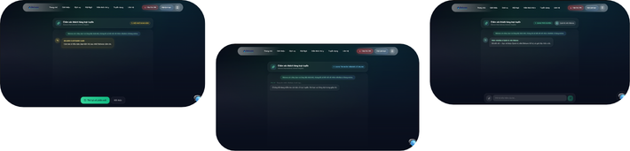
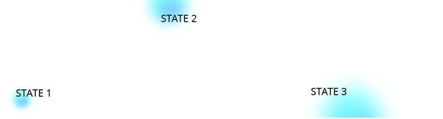

# Belwee Pet Clinic — Web Platform

> **Video Intro Logo:** [Xem `belwee-logo-intro-a.mp4`](./public/belwee-logo-intro-a.mp4)

  
  
  

Ứng dụng web toàn diện dành cho **Belwee Pet Clinic**, kết nối trực tiếp khách hàng nuôi thú cưng với đội ngũ bác sĩ và nhân viên phòng khám, phát triển trên nền tảng **Next.js (App Router)** và **TypeScript**.

---

## NGƯỜI PHÁT TRIỂN

- **Tác giả / Người phát triển:** Yujaaz (`khangcaheo300582-boop`)
- **Đơn vị áp dụng:** Belwee Pet Clinic
- **Chuyên môn & Vai trò:** Full-stack Web Development, UI/UX & Interactive Design, Digital Marketing & Conversion Flow, Security & QA Integration
- **Liên hệ:** `khangcaheo300582@gmail.com` • Facebook: **Gra Yujaa**

---

## TÍNH NĂNG

### 1. Chat & Hỗ trợ trực tiếp với khách hàng

Kênh nhắn tin và hỗ trợ trực tiếp giúp khách hàng trao đổi nhanh với đội ngũ tư vấn viên, gửi câu hỏi về tình trạng sức khỏe thú cưng và nhận phản hồi kịp thời.

  
  

### 2. Đặt lịch khám & Dịch vụ

Hỗ trợ khách hàng lựa chọn dịch vụ, theo dõi thông tin lịch hẹn và thao tác đặt lịch thuận tiện trên giao diện web.

### 3. Thông báo thông minh

Cập nhật thông báo, nhắc nhở và trạng thái tương tác để khách hàng nắm bắt thông tin nhanh chóng.

### 4. Kiến thức thú y & Cổng thông tin phòng khám

Cung cấp bài viết kiến thức thú y, thông tin dịch vụ và các chi nhánh phòng khám phục vụ khách hàng.

  
  

### 5. Phân quyền & Cổng nội bộ (`staff`)

Khu vực làm việc dành cho nhân viên và quản trị viên để xử lý nghiệp vụ và vận hành hệ thống.

  
  

_(Lưu ý: Nếu file ảnh đầu tiên trong thư mục `public/` của bạn có tên chính xác là `phân quyền 1.png`, hãy đổi đường dẫn tương ứng thành `./public/ph%C3%A2n%20quy%E1%BB%81n%201.png`)._

### 6. Giám sát hệ thống & Bảo mật

Theo dõi hoạt động hệ thống, kiểm soát bảo mật và hỗ trợ phát hiện sự cố kịp thời.

  
  

_(Lưu ý: Nếu file ảnh thứ hai trong `public/` có tên là `giám sát hệ thống 2.png`, hãy cập nhật lại chữ `hệ` thay cho `hộ` trên đường dẫn trên)._

---

## Công nghệ sử dụng

| Nhóm                      | Công nghệ                                        |
| :------------------------ | :----------------------------------------------- |
| **Frontend & Framework**  | Next.js (App Router), React, TypeScript          |
| **Giao diện & Hiệu ứng**  | Tailwind CSS, PostCSS                            |
| **Xác thực & Thông báo**  | NextAuth, Email OTP / SMTP                       |
| **Bảo mật & Giám sát**    | Sentry, Middleware, CSRF & Rate-Limit Protection |
| **Kiểm thử & Chất lượng** | Vitest, Playwright, ESLint, Husky                |

---

## Hướng dẫn cài đặt và chạy dự án (Local)

1. **Clone repository về máy:**
   Chạy lệnh `git clone https://github.com/khangcaheo300582-boop/demo-belwee-pet-clinic-by-yujaa.git` và di chuyển vào thư mục dự án.

2. **Cài đặt các gói thư viện:**
   Chạy lệnh `npm install` tại thư mục gốc `belwee-pet-clinic`.

3. **Cấu hình biến môi trường:**
   Tạo file `.env.local` từ file mẫu `.env.example` và điền đầy đủ các thông số kết nối.

4. **Khởi chạy môi trường phát triển:**
   Chạy lệnh `npm run dev`, sau đó mở trình duyệt tại địa chỉ `http://localhost:3000`.

---

## Cấu trúc thư mục

- `app/` — Hệ thống định tuyến (App Router), các trang giao diện người dùng, cổng `staff` và API routes
- `components/` — Các thành phần giao diện tái sử dụng
- `hooks/` — Custom React hooks xử lý tương tác và trạng thái giao diện
- `lib/` — Các module xử lý logic nghiệp vụ và tiện ích dùng chung
- `public/` — Tài nguyên tĩnh (hình ảnh, biểu tượng, media)
- `security/` — Cấu hình bảo mật, kiểm soát CSRF, rate-limit và xác thực request
- `scripts/` — Các script tự động hóa kiểm tra và xác minh hệ thống
- `tests/` — Bộ kiểm thử API contract và kiểm thử đầu cuối (E2E)
