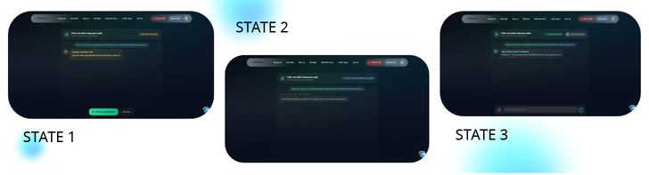

<p align="center">
  
</p>
# Belwee Pet Clinic — Web Platform
 
<table>
  <tr>
    <td width="68%" valign="middle">
      Ứng dụng web toàn diện dành cho <b>Belwee Pet Clinic</b>, kết nối trực tiếp khách hàng nuôi thú cưng với đội ngũ bác sĩ và nhân viên phòng khám, phát triển trên nền tảng <b>Next.js (App Router)</b> và <b>TypeScript</b>.
    </td>
    <td width="32%" align="center" valign="middle">
      
    </td>
  </tr>
</table>
---
 
## NGƯỜI PHÁT TRIỂN
 
<table>
  <tr>
    <td width="68%" valign="middle">
      <b>Tác giả / Người phát triển:</b> Yujaaz (<code>khangcaheo300582-boop</code>)<br>
      <b>Đơn vị áp dụng:</b> Belwee Pet Clinic<br>
      <b>Chuyên môn &amp; Vai trò:</b> Full-stack Web Development, UI/UX &amp; Interactive Design, Digital Marketing &amp; Conversion Flow, Security &amp; QA Integration<br>
      <b>Liên hệ:</b> <code>khangcaheo300582@gmail.com</code> • Facebook: <b>Gra Yujaa</b>
    </td>
    <td width="32%" align="center" valign="middle">
      
    </td>
  </tr>
</table>
<p>
  <a href="https://github.com/khangcaheo300582-boop"></a>
  <a href="https://facebook.com/"></a>
  <a href="mailto:khangcaheo300582@gmail.com"></a>
</p>
---
 
## TÍNH NĂNG
 
- **Đặt lịch và theo dõi trạng thái lịch hẹn theo thời gian thực** qua các bước **State 1 → State 2 → State 3**, khách hàng nhận cập nhật tức thì từ phòng khám.
<p align="center">
  
</p>
- **Danh mục dịch vụ theo nhóm** dạng thẻ, giúp khách hàng chọn đúng dịch vụ phù hợp cho thú cưng.
<p align="center">
  
</p>
- **Giao diện trang chủ và kết nối thú y**, tối ưu chuyển đổi khách hàng.
<p align="center">
  
  
</p>
- **Giám sát hệ thống:** theo dõi hoạt động, ghi log và phát hiện bất thường để vận hành ổn định.
<p align="center">
  
  
</p>
- **Phân quyền truy cập** theo vai trò (quản trị, nhân viên, khách hàng), đúng người đúng chức năng.
<p align="center">
  
  
</p>
---
 
## Công nghệ sử dụng
 
| Nhóm | Công nghệ |
| --- | --- |
| Frontend & Framework | Next.js (App Router), React, TypeScript |
| Giao diện & Hiệu ứng | Tailwind CSS, Framer Motion |
| Xác thực & Thông báo | NextAuth, Nodemailer (SMTP), SSE |
| Bảo mật & Giám sát | Sentry, Middleware, CSRF & Rate Limit Protection |
| Kiểm thử & CI/CD | Vitest, Playwright, GitHub Actions |
 
---
 
## Hướng dẫn cài đặt và chạy dự án (Local)
 
### Yêu cầu chung
 
- **Node.js** 18.18 trở lên (khuyến nghị bản LTS 20)
- **Git**
- Trình soạn thảo bất kỳ (VS Code, v.v.)
Kiểm tra đã cài chưa:
 
```bash
node -v
npm -v
git --version
```
 
<details open>
<summary><b>🪟 Windows (PowerShell hoặc CMD)</b></summary>
&nbsp;
 
1. **Cài Node.js và Git** (bỏ qua nếu đã có):
```powershell
winget install OpenJS.NodeJS.LTS
winget install Git.Git
```
 
Sau khi cài, mở lại terminal.
 
2. **Clone và vào thư mục dự án:**
```powershell
git clone https://github.com/khangcaheo300582-boop/demo-belwee-pet-clinic-by-yujaa.git
cd demo-belwee-pet-clinic-by-yujaa
```
 
3. **Cài thư viện:**
```powershell
npm install
```
 
4. **Tạo file môi trường:**
```powershell
copy .env.example .env.local
```
 
Mở `.env.local` và điền các giá trị cần thiết (database, SMTP, secret xác thực...).
 
5. **Chạy môi trường phát triển:**
```powershell
npm run dev
```
 
> Nếu PowerShell báo lỗi chặn script, chạy: `Set-ExecutionPolicy -Scope CurrentUser RemoteSigned`
 
</details>
<details>
<summary><b>🐧 Linux (Ubuntu/Debian và tương tự)</b></summary>
&nbsp;
 
1. **Cài Node.js và Git** (bỏ qua nếu đã có):
```bash
sudo apt update
sudo apt install -y git curl
curl -fsSL https://deb.nodesource.com/setup_20.x | sudo -E bash -
sudo apt install -y nodejs
```
 
2. **Clone và vào thư mục dự án:**
```bash
git clone https://github.com/khangcaheo300582-boop/demo-belwee-pet-clinic-by-yujaa.git
cd demo-belwee-pet-clinic-by-yujaa
```
 
3. **Cài thư viện:**
```bash
npm install
```
 
4. **Tạo file môi trường:**
```bash
cp .env.example .env.local
nano .env.local
```
 
5. **Chạy môi trường phát triển:**
```bash
npm run dev
```
 
</details>
<details>
<summary><b>🍎 macOS</b></summary>
&nbsp;
 
1. **Cài Node.js và Git** bằng [Homebrew](https://brew.sh) (bỏ qua nếu đã có):
```bash
brew install node git
```
 
2. **Clone và vào thư mục dự án:**
```bash
git clone https://github.com/khangcaheo300582-boop/demo-belwee-pet-clinic-by-yujaa.git
cd demo-belwee-pet-clinic-by-yujaa
```
 
3. **Cài thư viện:**
```bash
npm install
```
 
4. **Tạo file môi trường:**
```bash
cp .env.example .env.local
open -e .env.local
```
 
5. **Chạy môi trường phát triển:**
```bash
npm run dev
```
 
</details>
### Sau khi chạy
 
Truy cập: http://localhost:3001
 
### Lệnh hữu ích khác (mọi hệ điều hành)
 
```bash
npm run build            # Build bản production
npm run start            # Chạy bản production sau khi build
npm run test             # Chạy unit test (Vitest)
npx playwright install   # Cài trình duyệt cho e2e test (chỉ cần chạy 1 lần)
```
 
---
 
## Cấu trúc thư mục
 
```text
demo-belwee-pet-clinic-by-yujaa/
├── app/                   # Next.js App Router: pages, layouts, API routes
│   ├── api/               # Route handlers (API)
│   └── (pages)/           # Các trang giao diện
├── components/            # Component giao diện dùng chung
├── lib/                   # Logic nghiệp vụ, tiện ích, cấu hình
├── public/                # Ảnh, video, logo dùng cho giao diện và README
├── screenshots/           # Ảnh chụp màn hình dự án
├── middleware.ts          # Middleware xác thực, bảo mật
├── next.config.mjs        # Cấu hình Next.js
├── tailwind.config.ts     # Cấu hình Tailwind CSS
├── vitest.config.ts       # Cấu hình unit test
├── playwright.config.ts   # Cấu hình e2e test
└── README.md
```
 
<p align="center">
  <sub>© Belwee Pet Clinic — Phát triển bởi Yujaaz</sub>
</p>
 
